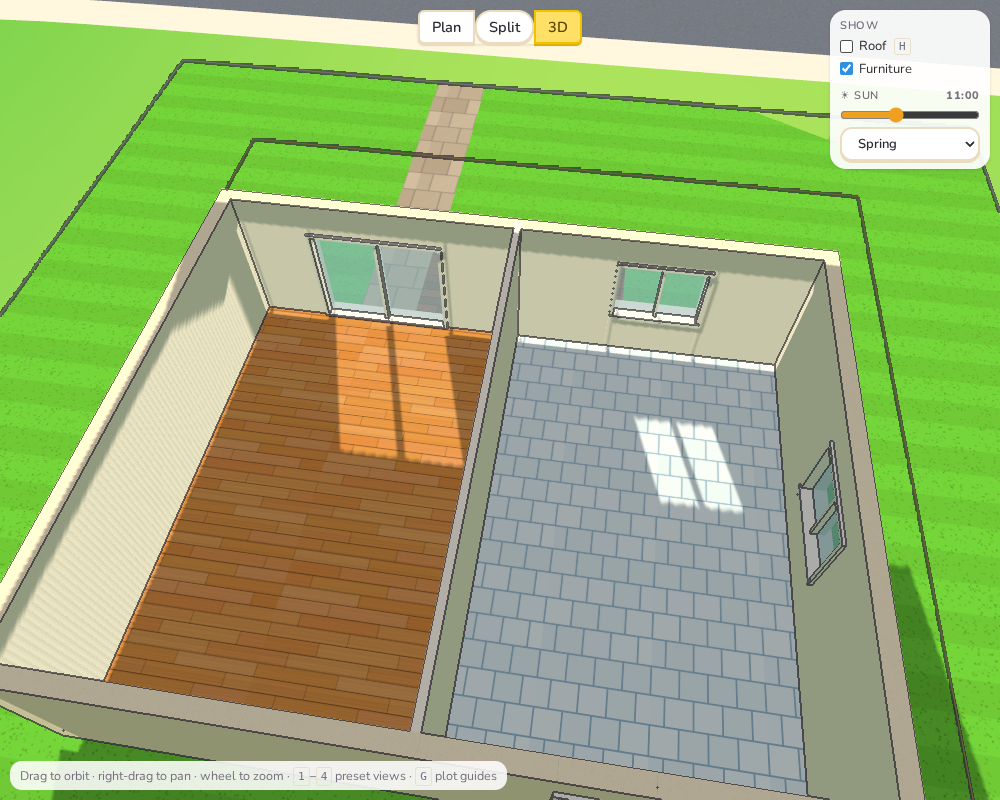
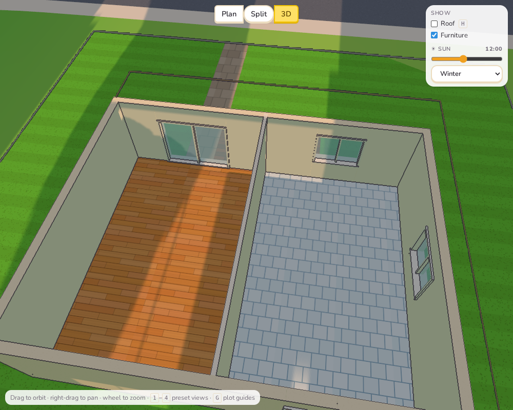
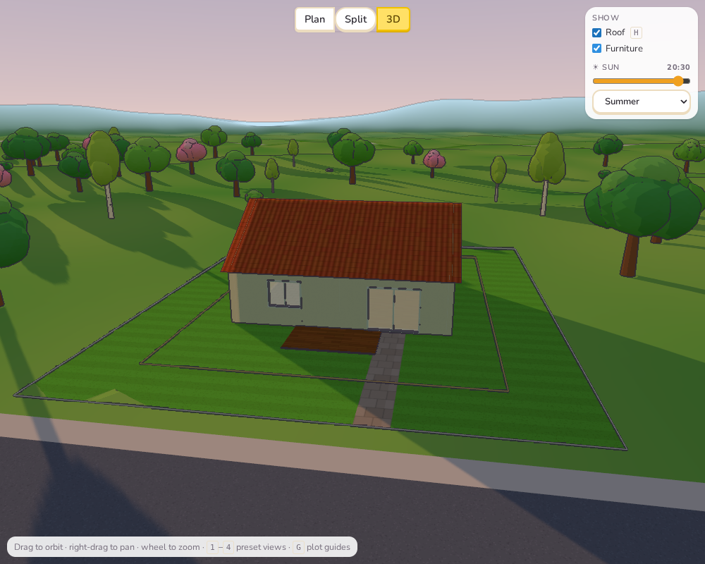
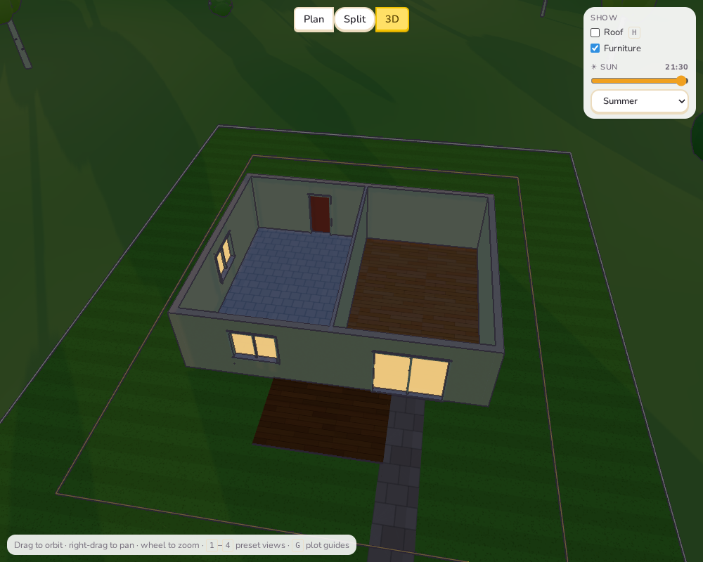

# Sprint 1: Sun and light

## Plan

- A sun slider in the 3D view: time of day and season, with the sun where it really is.
- Shadows that show how the light comes into the house, also when the roof or upper
  floors are hidden to look inside.
- Evening light: a lower, warmer sun, a darker sky, windows lit at dusk.
- A compass in the plan, so players know which way their rooms face.
- How many hours of sun each terrace and balcony gets, shown in its menu.
- Clients who wish for a sunny terrace or a balcony with sunset views.

## What was done

**The sun (`src/core/sun.ts`).** Sun positions come from the standard solar formulas
(declination and hour angle) at 59° north, Sweden, for four days: the spring and autumn
equinoxes and the summer and winter solstices. North is the back of every plot (up in the
plan), so the street side faces south, east is on the right of the plan and west on the
left. At midsummer the sun is up for about 18½ hours and stands 54° high at noon; in
midwinter it is up for about 6 hours and never higher than 7½°.

**In the 3D view.** The Show panel has a **☀ Sun** slider (04:00–22:00) and a season
menu. The sun light follows them: its direction, strength and colour (golden when low),
the sky (pink at the horizon at sunset, deep blue at dusk), and the windows glow warm
when it gets dark. The area that gets shadows grows as the sun sinks, so long evening
shadows are not cut off.

**Light into the house.** When the roof or upper storeys are hidden to look inside, they
are still built, invisibly, just to cast their shadows (`buildShadowCaster` in
`scene.ts`). So with the roof off you see the rooms as they really are under it: in shade,
with patches of sun falling through the windows and glass doors, moving through the day,
short at a summer noon and deep into the room in winter.

**Evening.**

**Sun on terraces and balconies (`balconySun` in `features.ts`).** Every quarter of an
hour from sunrise to sunset at the spring equinox, a ray from the middle of the terrace,
at sitting height, is followed towards the sun; if it passes under any storey's top or
the roof, the terrace is in the house's shade. The terrace or balcony menu shows the
result, for example "☀ 9.5 h of sun in spring · evening sun in summer". "Evening sun"
means direct sun in the last hour before a midsummer sunset.

**Clients.** Two new kinds of wish: *a terrace or balcony with at least N hours of sun*
(retirees 6 h, families 5 h, villas 7 h) and *a balcony or terrace with the evening sun*
(couples, villas). They need the Terraces technique in the campaign.

**Compass.** A small compass in the plan's corner shows north (up).

## Tests

- `sun.test.ts`: the sun is due south at noon at the right height, rises in the east,
  the days are long in summer and short in winter; a south terrace gets far more sun than
  a north one, a west terrace gets the evening sun and an east one does not.
- All 192 unit tests and the end-to-end tests pass.

## Deviations and notes

- **Only the house casts shade in the sun-hour count.** Trees, neighbours and the land
  (a hill in the west) are left out of the terrace calculation, although they do cast
  shadows in the 3D view. A terrace may show more hours than it would really get on a
  wooded plot. Counting them is possible but slow; a later sprint could add trees.
- **Shadows from a sun at least 7° up.** Lower, shadows run hundreds of metres and the
  shadow map's detail becomes too coarse; below 7° the light still gets weaker and
  redder, but the shadows stop lengthening.
- **A bug found on the way:** the invisible shadow-casting roof was first made with a
  one-sided material, and three.js draws shadows from back faces, so a thin roof cast no
  shadow at all. It is now double-sided.
- **Solar time, not clock time.** 12:00 is when the sun is due south (in Sweden in summer
  that is about 13:30 on the clock). Simpler for players, and it keeps "noon" meaning noon.
- Not done: playing the day as an animation. The slider can be dragged; an automatic
  sweep fits better with the camera work in Sprint 2.
