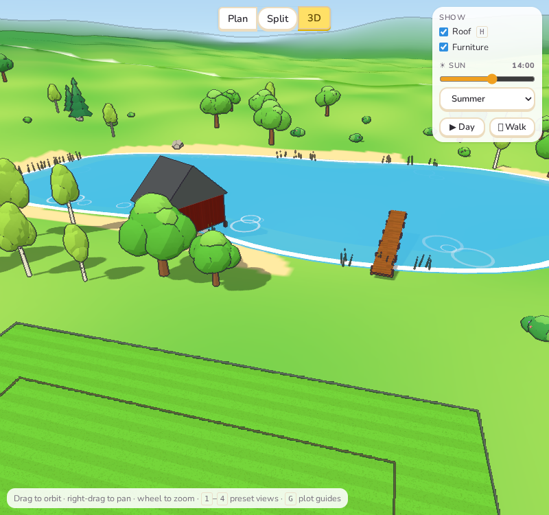
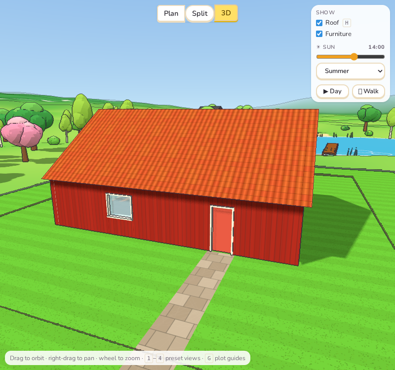
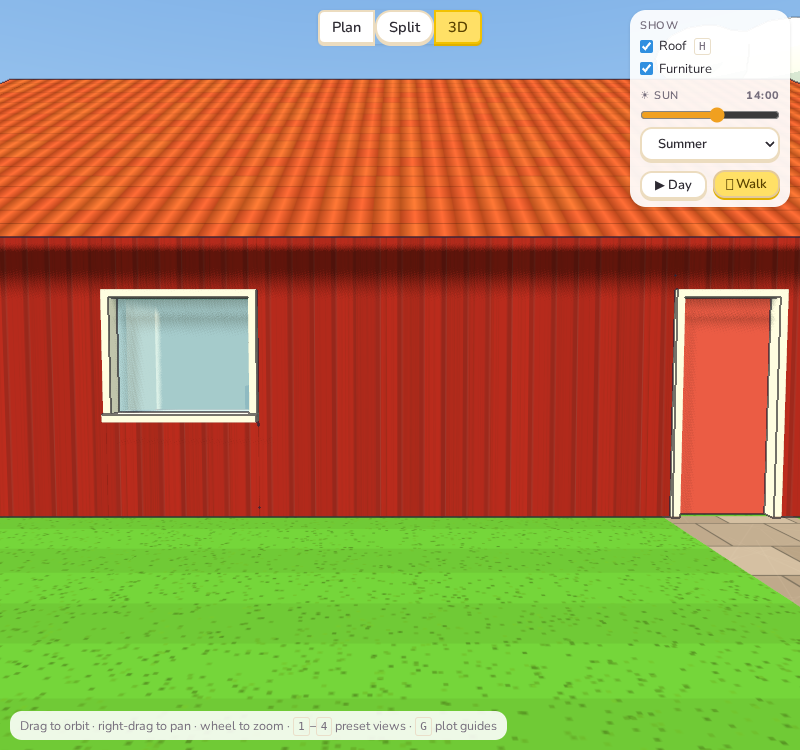

# Sprint 2: Atmosphere and camera

## Plan

- Softer shadows, and contact shading where the house meets the ground.
- Wind in the trees and reeds, drifting clouds.
- Water with ripples and shallows.
- Smooth camera moves between the preset views.
- An eye-level walk mode.
- (Carried over from Sprint 1) playing the day: the sun moving on its own.

## What was done

**Moving things.** The 3D view now draws continuously while it is visible, so trees sway
in gusts (birches more, bushes less, each tree on its own rhythm), reeds bend, clouds drift
across the sky and come round again, and rings ripple and fade on lakes, rivers and the sea.
Everything is driven by one `World.update(t)` in `landscape.ts`.

**Water depth.** Lakes get a darker area a few metres in from the shore, so the shallows
by the beach are lighter.

**Contact shade.** A soft dark band on the ground round the foot of the house, fading out
over 1.4 m, as if little sky light reached in under the eaves. Shadow edges are softened
(a blur radius on the sun's shadow map).

**Camera.** The preset views (keys 1–4) glide there in 0.7 s instead of jumping, turning the
short way round. Dragging or zooming during a glide takes over at once.

**Walk.** **🚶 Walk** in the Show panel puts you at eye height (1.6 m) on the plot's road
side, facing the house. Arrow keys or WASD walk and turn, dragging looks round, the wheel
steps forward or back, Esc (or the button again) stops. Inside the house you walk on its
floor; outside, on the ground, up and down the slopes.

**▶ Day** plays the day: the sun moves two hours a second, and starts again in the
morning after dusk.

## Tests

All 192 unit tests and the end-to-end tests pass. The moving parts were checked in
screenshots: ripples on the lake, a preset view halfway through its glide, and walking
forward with the arrow key and stopping with Esc.

## Deviations and notes

- **No screen-space ambient occlusion.** The plan said "ambient occlusion"; a real SSAO
  pass would mean a third render of the scene on top of the outline passes, too slow on
  modest computers. The contact shade round the house gives most of the effect where it
  matters, for a fraction of the cost. Corners inside rooms are not darkened.
- **Soft shadows:** this version of three.js no longer has its "soft" shadow map type; the
  ordinary PCF shadows with a blur radius are used instead.
- **Movement is off in automated tests.** When the browser is driven by a test
  (`navigator.webdriver`), nothing moves, so screenshots and checks see the same picture
  every time.
- **Walking goes through walls.** There is no collision with walls or furniture: simpler,
  and handy for stepping from room to room. Stairs are not climbed; walking on the ground
  floor and the ground only.
- **Water:** ripples are rings that grow and fade rather than a wavy surface; rivers do not
  flow. The sea shore has no breaking waves yet.
- **Further-away detail (LOD)** moved to Sprint 7, where it is needed for the extra houses
  and life.
