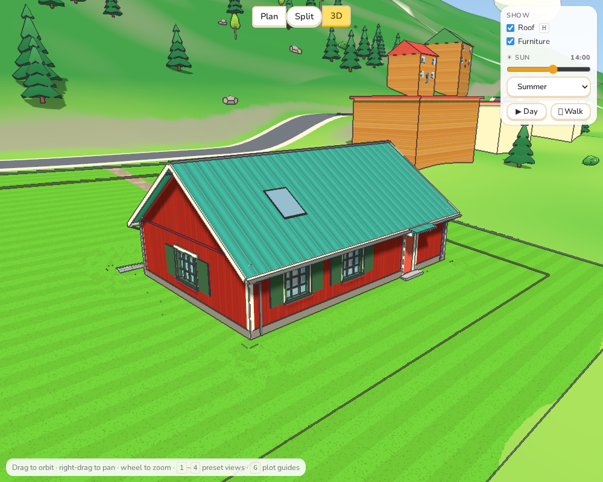
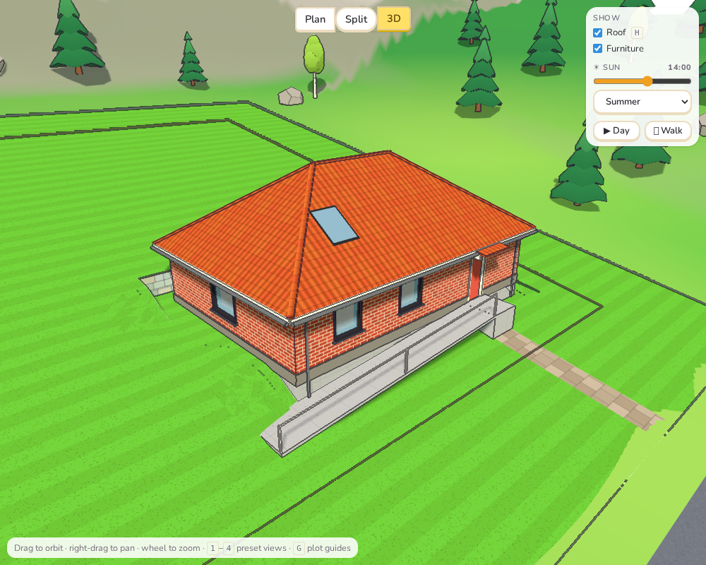
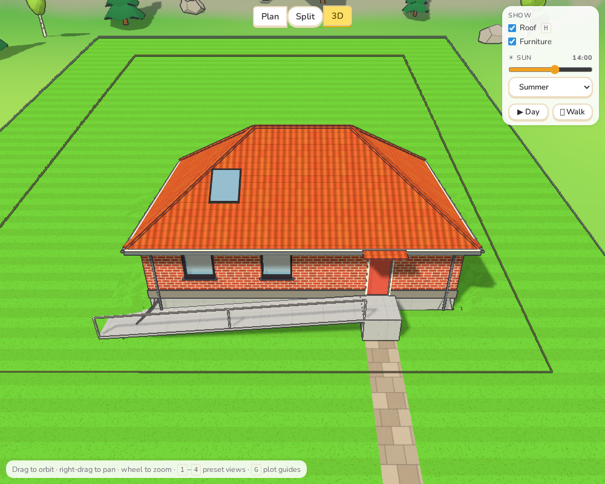
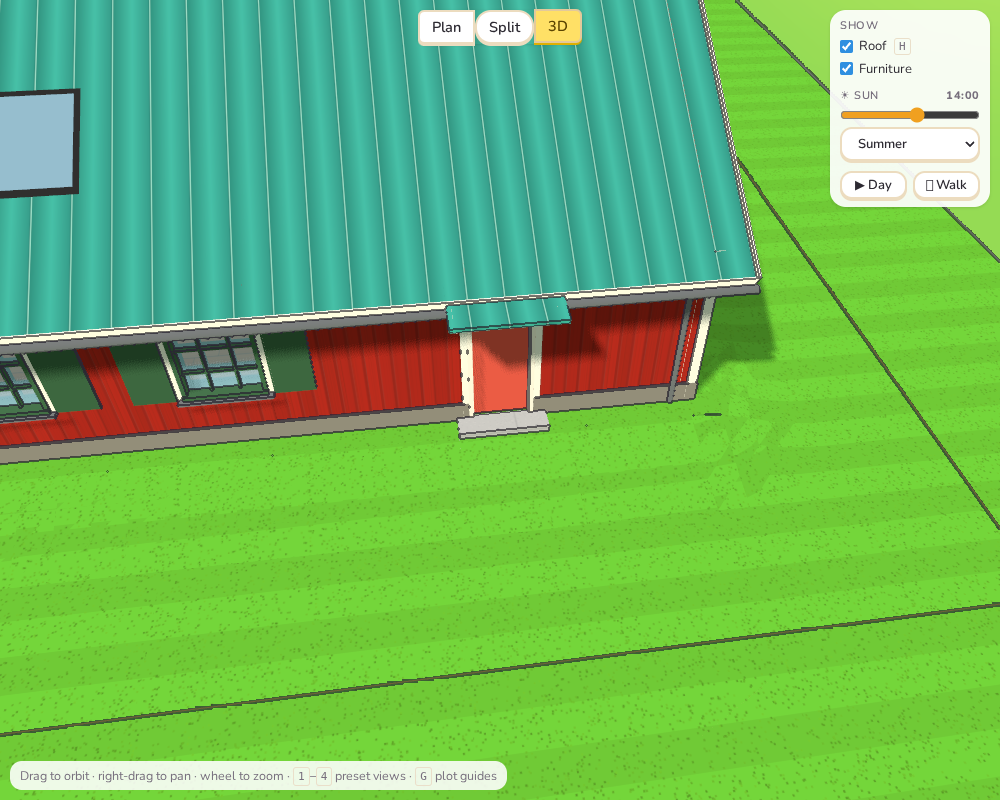

# Sprint 3: House details

## Plan

- Window sills, lintels and shutters; door canopies.
- A plinth round the foot of the house, and corner boards on wooden facades.
- Gutters and down pipes, fascia and barge boards, a cap on the ridge.
- Skylights: roof windows lying in the slope.
- Window styles to choose from, and frame colours.
- Steps, or a ramp, up to outside doors that are above the ground.

## What was done

**Windows and doors.** Every window and outside door now has:

- **A style** (windows only):
  - *Standard*: as before.
  - *Cottage*: small panes and shutters folded back on each side.
  - *Modern*: a slim dark frame with no glazing bars.
- **A frame colour**: white, black, green, blue or red. Cottage shutters take the frame
  colour, and are green when the frame is white.

Both are in the window or door menu. On the outside, every window gets a metal sill, and
how each opening is trimmed depends on the facade:

- **Brick and stone:** a pale stone lintel over each opening.
- **Wood and Falu red:** white trim boards, the classic Swedish window surround.
- **Plaster and concrete:** nothing extra.

A ground-floor front or back door gets a small roof on two brackets, in the house's roof
covering. There is none where a terrace meets the door.

**The walls.**

- **Plinth:** a grey band, 32 cm high, runs round the foot of the ground floor and stops
  at doors. Stone facades have none.
- **Corner boards:** wooden and Falu red facades get white boards at every corner, up to
  the top of the storey.

**The roof** (`RoofGeometry.edges` in `roof.ts`). The roof now reports its edges:

- eaves, with which way is out;
- the ridge and hips;
- the verges over gables;
- a down pipe at each closed corner.

The 3D view hangs these on them:

- a white fascia and a round metal gutter along every eave;
- white barge boards up the gables;
- a cap along the ridge and hips;
- down pipes that run from the gutter's end back to the wall, then straight down to the
  ground, however far that is on a slope.

On L, T and U houses, edges that run under another wing's roof are clipped away, and a
down pipe that would stand inside the house is dropped.

**Skylights.**

- **Where they are added:** *+ Skylight* in the Roof menu (on the side away from the
  road) and in the menu of any top-floor outer wall.
- **How they behave:** a skylight is a dormer that lies flat in the slope: a dark frame
  with glass, just proud of the roof covering. It is placed and dragged like a dormer, and
  shows as a pale blue dashed outline in the plan.
- **Cost:** about a third of a dormer (1,300 kr plus a little per metre).
- **Technique:** *Skylights*, a new technique in the roofs branch (3,000 kr). It is
  separate from Dormers.

**Steps and ramps** (`doorApproaches` in `features.ts`). Where a ground-floor outside
door's floor is at least 12 cm above the ground in front of it, the house gets concrete
steps up to it:

- **Steps:** a landing at the door and one step per 17 cm of rise.
- **Ramp:** the door's menu shows how high the floor is there, and lets you choose
  **Steps** or **Ramp**. The ramp has a 1.5 m landing at the door, then runs along the
  facade at 1 in 12 with a handrail, towards the longer side of the wall.

Both show in the plan (grey, with a line for each step). They are paid for in the access
costs: 140 kr per step, or 260 kr per metre of ramp.

## Tests

- `details.test.ts` (9 new tests):
  - **Roof edges:**
    - gable roof: eaves, ridge, verges and down pipes;
    - hip roof: eaves all round and five ridge lines;
    - L-shaped house: no gutter or ridge under another wing's roof, and no down pipe inside
      the house.
  - **Steps and ramps:**
    - step count and direction;
    - ramp length;
    - none on level ground or where a terrace meets the door;
    - steps are billed on a sloping plot.
  - **Skylights:** placed in the slope, cheaper than a dormer, and need their own technique.
  - **Saving:** window style, frame colour, ramp and skylight survive saving and loading,
    and plain openings save nothing extra.
- e2e: adds a skylight from the Roof menu, and sets a window to Cottage with a green
  frame from its menu.
- All 201 unit tests, the end-to-end tests and the build pass.

## Deviations and notes

- **Ramps can be long.** At 1 in 12, a door 0.85 m up needs a 10 m ramp. It runs along
  the facade instead of straight out (my first attempt went straight out and ran off the
  plot). A long ramp can run past the corner of the house; a switchback ramp would be the
  real answer.
- **Skylights don't let sun in yet.** The invisible roof that casts shadows when the roof
  is hidden (Sprint 1) has no hole where a skylight is, so no sun patch falls through it.
  Cutting holes in the roof surface needs polygon clipping that the roof doesn't have
  yet. Skylights do count as daylight for the room, like dormers.
- **Frames are one colour, inside and out.** Frame colours apply on outer walls; inside
  doors stay white.
- **A bug found on the way:** vertical down pipes first came out tilted. Three.js
  `lookAt` is undefined when the direction is the same as "up", so pipes pointing
  straight down now use a different up vector.
- **Plan steps vs. 3D steps.** The plan draws steps from the cost calculation's numbers
  (risers of about 17 cm). The 3D steps have one tread fewer than risers plus a landing,
  so the depth shown in the plan can be one tread longer.
- Not done: window styles for dormer windows (they stay standard).
