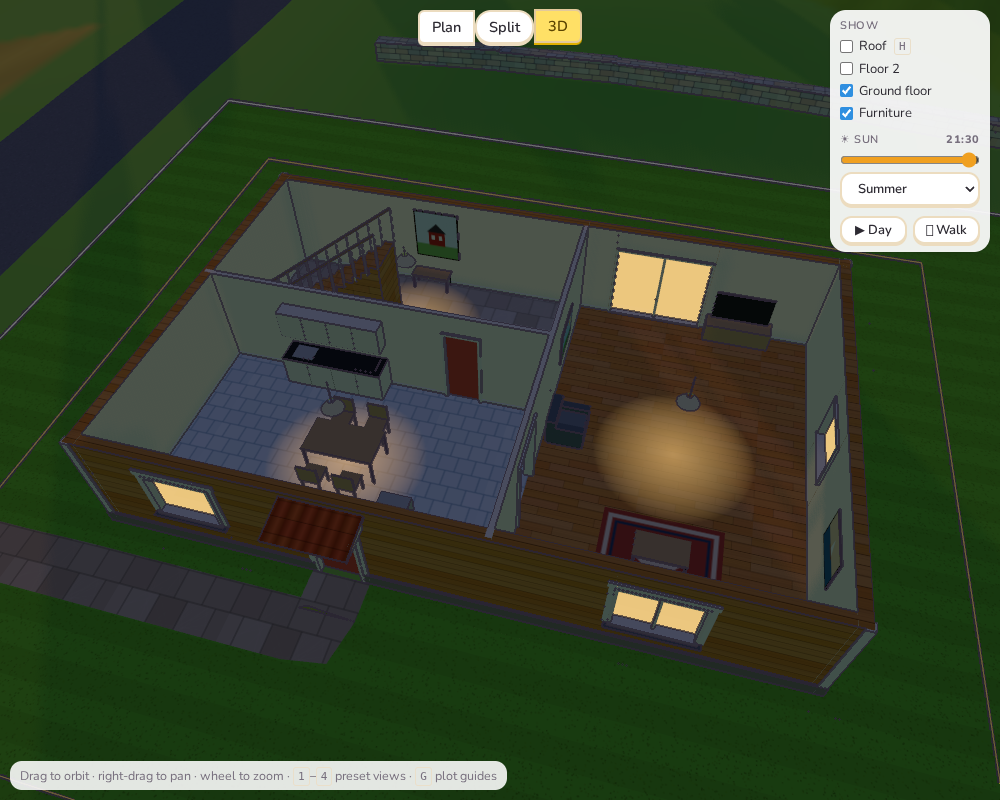
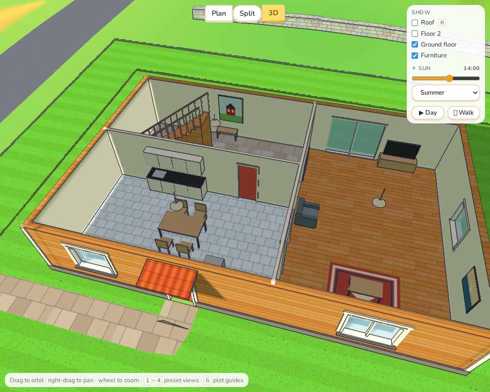
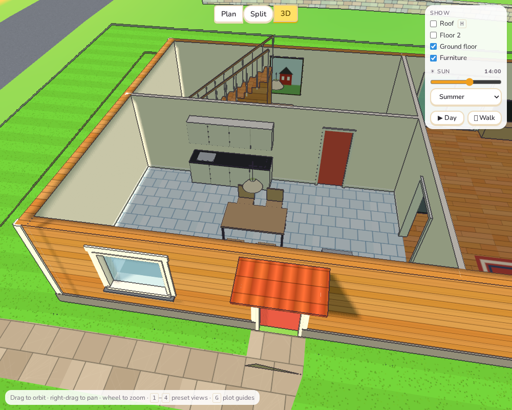
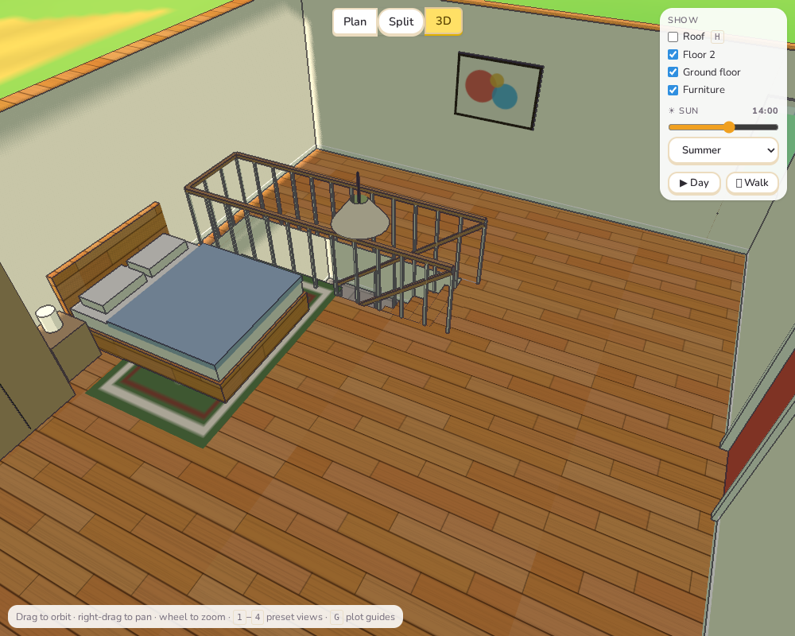

# Sprint 4: Interiors

## Plan

- Ceiling lights.
- Rugs.
- Pictures on the walls.
- Skirting boards.
- Kitchen cabinets along the walls.
- Railings on stairs and round stairwells.

## What was done

**Decor follows from the house (`src/core/decor.ts`).** None of this is furniture the
player places, buys or drags. `decorate(house)` works out where everything goes from the
rooms and the furniture already in them. When the furniture moves or a room changes use,
the decor follows. It costs nothing, and the plan stays uncluttered. It is drawn by the
new `src/game/interior3d.ts`. Lamps, rugs, pictures and cabinets go with the
**Furniture** toggle; railings are always there.

**Ceiling lamps.** Every room with a use gets a lamp in its middle, hanging on a cord:

- living rooms and kitchens: a pendant 60 cm down;
- other rooms: 30 cm down.

At dusk the lamps light up, and a soft warm pool of light falls on the floor under each
one. The pool never reaches past the room's walls. The lamps use the same evening
setting as the glowing windows from Sprint 1, so they come on as the sun goes down.

**Rugs.** These go:

- under the coffee table (or in front of the sofa when there is no table);
- under the foot of each bed, wider than the bed;
- under a dining table outside the kitchen.

A rug is shrunk until it lies at least 15 cm from every wall. There are four designs (a
red rug with a diamond, blue stripes, green rings, beige bands); each room gets one.

**Pictures.** Living rooms, bedrooms, halls and offices get a framed picture, and big
living rooms get two, on different walls. Each one:

- **Where:** hangs in the middle of the longest free stretch of wall facing into the room,
  at 1.55 m;
- **Kept clear of:** windows and doors (30 cm each side), and tall furniture such as
  wardrobes and bookcases;
- **What:** one of five little paintings drawn in code: hills and a sun, a sailing boat, coloured
  circles, flowers, and a red cottage.

**Kitchen wall cabinets.** A counter against a wall gets a row of white wall cabinets
over it, with door gaps every 60 cm. Where a window is in the way over the counter, it
gets none. A kitchen with its counter under the window keeps the view.

**Skirting boards.** A white board 9 cm high runs along the foot of every wall side that
faces a room: both sides of inner walls, the inside of outer walls. It stops at doorways,
glass doors and openings.

**Stair railings.** Each flight gets a wooden handrail on balusters along every side that
is not against a wall. Upstairs, the stairwell gets a railing round its open edges, but
not along walls and not at the top end where you step off.

## Tests

- `decor.test.ts` (6 new tests):
  - a lamp in every room;
  - a rug centred under the coffee table, running along it and inside the room;
  - a rug near a wall shrinks to fit;
  - pictures never over the window or the bookcase, always facing into the room, and none
    in the kitchen;
  - wall cabinets over a counter, but not when a window is put behind it;
  - a stair against a wall gets one flight rail, and its stairwell gets rails on its open
    edges only.
- All 207 unit tests, the end-to-end tests and the build pass.

## Deviations and notes

- **Decor is automatic, not placed.** The plan listed rugs and pictures as things to
  have; I made them follow from the rooms instead of adding six new furniture kinds to
  buy and place. Players can't choose a rug's design or move a picture. If kids want
  that, decor items could later become furniture with these rules as their defaults.
- **Lamps don't really light the room.** The pool of light is a soft disc drawn on the
  floor, not a real light; dozens of real lights would make the toon renderer slow in
  software WebGL. The walls round a lamp don't brighten.
- **Skirting has no outline.** At 2 cm thick, the outline pass drew it as a dotted line,
  so it is left out of that pass and shows as a plain white strip.
- **Cabinets are all or nothing.** Where a window overlaps any part of a counter, the
  whole row of cabinets is left out, instead of cabinets either side of the window.
- **Kitchen cabinets "along the walls".** The plan also meant laying counters out along
  walls. The furnishing already puts counters against walls, so this sprint added the
  wall cabinets above them rather than changing how kitchens are furnished.
- **A mistake on the way:** my first test house had a staircase poking through the outer
  wall. That was my placement in the screenshot script, not the game; the game warns
  about stairs that don't fit.
