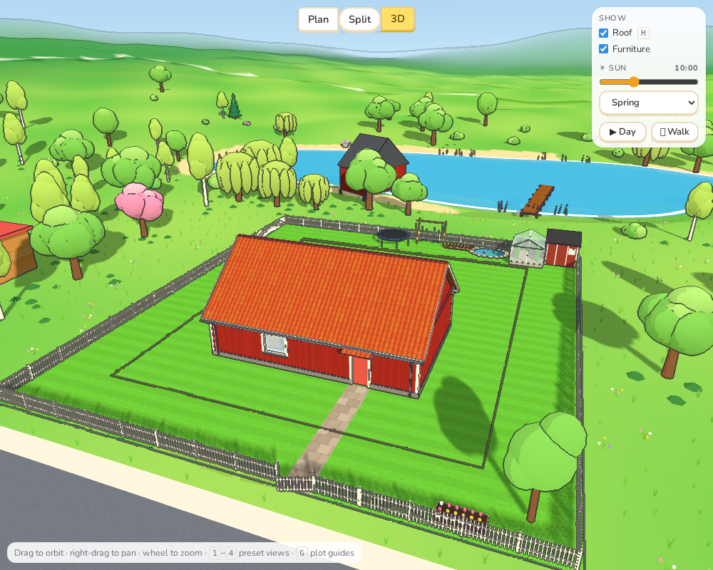
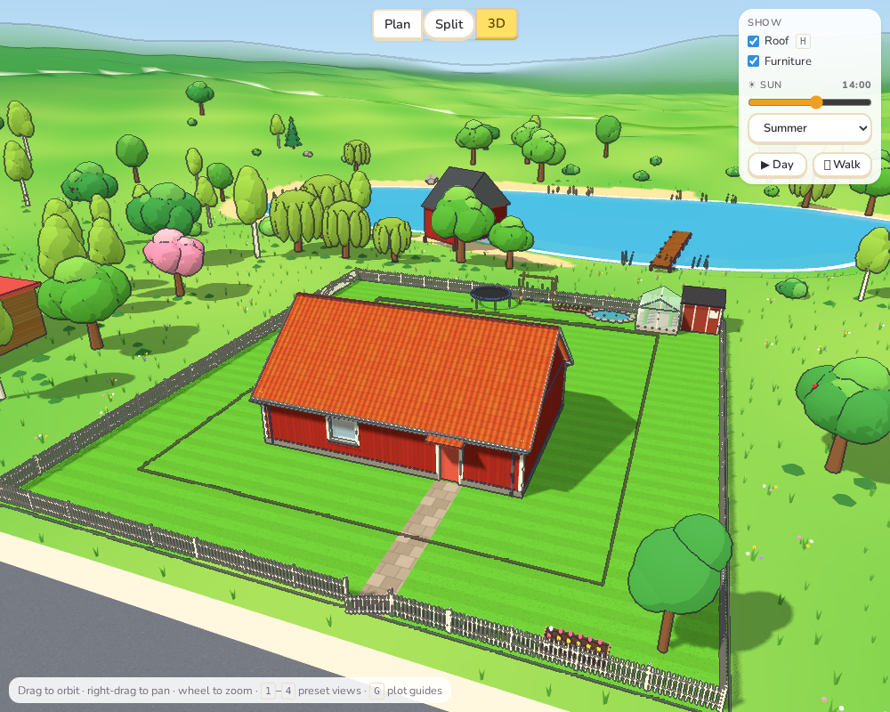
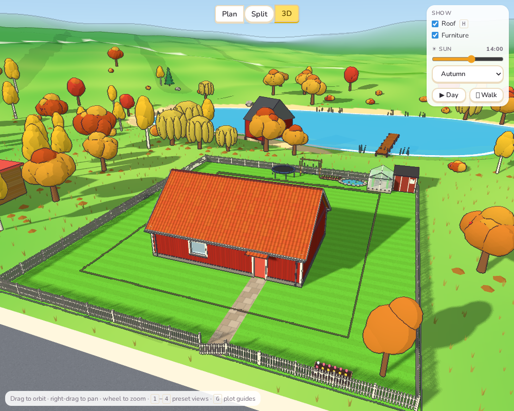
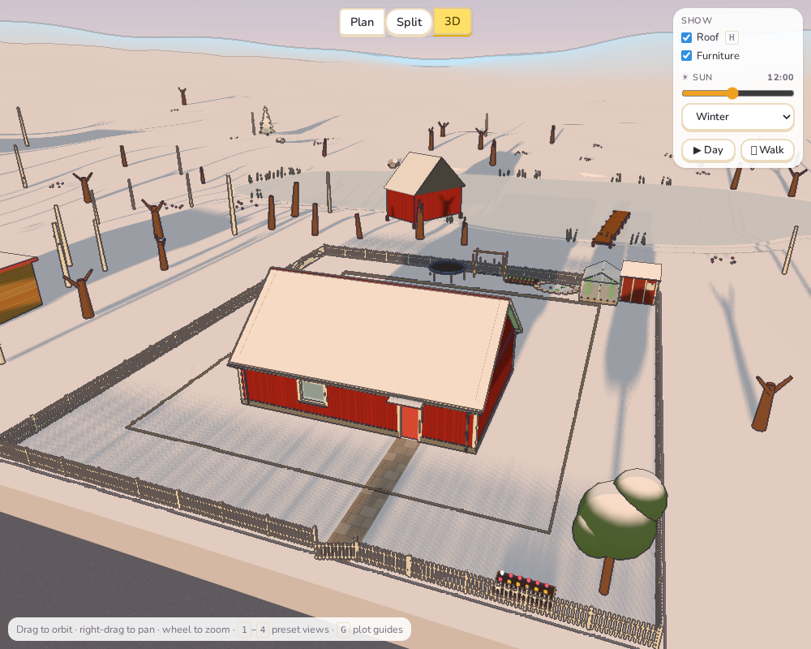
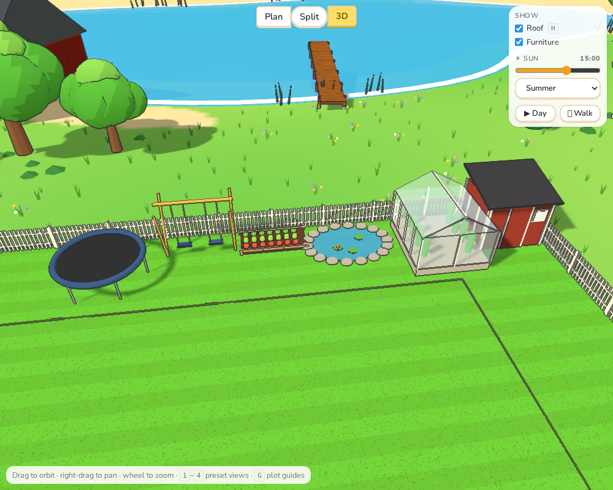

# Sprint 5: Plants, seasons and the garden

## Plan

- More kinds of tree: oaks, willows, maples, palms, stumps.
- Ground cover: long grass, wildflowers, ferns.
- Seasons, with snow in winter.
- Garden things: fences and gates, sheds, greenhouses, ponds, vegetable patches, swings,
  trampolines.

## What was done

**Trees** (`TreeKind` in `scenery.ts`, drawn in `landscape.ts`). Four new kinds:

- **Oaks:** a thick short trunk, spreading boughs, a broad low crown.
- **Maples:** a tall, dense, round crown.
- **Willows:** a leaning trunk with curtains of leaves hanging down, only by the water.
- **Stumps:** felled trees, here and there in the woods.

They are chosen by *place*: a tree that would have been a garden "round" tree becomes an
oak or a maple, a birch on the shore becomes a willow, and so on. This needs no extra
random draws, so every other tree on every plot stays exactly where it was. The plan
shows each kind in its own colour and size.

**Ground cover.** Long grass, wildflowers (white, yellow, pink and purple), and ferns
under the trees cover the land for 70 m round the plot. They thin out with distance and
keep off the lawn, the roads and the water. They are instanced: thousands of tufts cost
three draw calls. They are also left out of the outline pass, where they would turn into
a scatter of dark dots.

**Seasons.** The season menu from Sprint 1 now dresses the whole world (`applySeason` in
`textures.ts`):

| | Spring | Summer | Autumn | Winter |
|---|---|---|---|---|
| Leaves | fresh, light green | green | orange, yellow, red (maples), brown (oaks) | bare branches |
| Fruit trees | pink blossom | green, apples | yellow, apples | bare |
| Pines | green | green | green | green, with snow on every tier |
| Ground, roofs, rocks | — | — | ferns brown, flowers gone | snow on everything facing up |
| Lakes, rivers, ponds | — | — | — | frozen |

The snow is a small shader patch (`snowy`): every outdoor surface facing up turns white,
and less so the steeper it is. That covers the land, the lawn, roofs (the house's, sheds'
and neighbours'), rocks, stone walls and pine needles. Roads stay clear. Indoor floors
are never patched, so no snow falls inside. The sea doesn't freeze.

**Garden things.** The Garden menu has a second row: **Shed**, **Greenhouse**, **Pond**,
**Vegetable patch**, **Swing** and **Trampoline**:

- **Pieces:** each is a piece of garden furniture with its own 3D model and plan symbol.
  - The shed is Falu red with a felt roof.
  - The greenhouse has tomato plants inside.
  - The pond has stones round it and lily pads.
  - The vegetable patch has rows of crops.
  - The swing has two seats.
  - The trampoline has a ring and legs.
- **Placement:** they are dragged and turned like plants. New ones go in the **back
  garden**, away from the road, when there is room.
- **Cost:** they cost from 350 kr (vegetable patch) to 6,500 kr (shed).
- **Technique:** they need the Landscaping technique, like plants.

**Fences.** The Garden menu has a fence choice: **None**, **Picket** (white) or **Board**
(Falu red):

- **Where it runs:** round the plot, a little inside its edge, following the ground.
- **Gates:** where the path to the door crosses it, there is a gate standing a little
  open. Where the drive crosses it, there is an open gap between two posts.
- **Cost:** 220 or 310 kr a metre (not counting the gaps), and 1,400 kr a gate.
- **Saving:** the fence is saved with the design and drawn in the plan.

**New wishes.** Families may wish for *a swing or a trampoline for the children*, and
retirees for *a vegetable patch or a greenhouse* (at higher tiers, like the other extra
wishes).

## Tests

- `garden.test.ts` (6 new tests):
  - **Fences:**
    - the fence runs round the plot with one gate (the path) and one gap (the drive), both
      on the street side, and its length is the perimeter minus the gaps;
    - it is billed per metre plus the gate, and saved and loaded.
  - **Garden things:**
    - they stand outdoors, cost something, and are not counted as plants;
    - a swing meets the family's wish.
  - **Placement:** the shed goes behind the house, and nothing lands on the drive or the
    path.
  - **Trees:** all four new kinds appear across the plots, and willows grow only near
    water.
- e2e: the Garden menu now has ten locked items before Landscaping is learned. In free
  play it adds a swing, and the picket fence is turned on (it appears in the plan) and off
  again.
- All 213 unit tests, the end-to-end tests and the build pass.

## Deviations and notes

- **No palms.** Every plot is in Sweden at 59° north. Palms would look out of place, so
  I left them out.
- **Garden trees keep their leaves in winter.** The garden tree and shrub the player
  plants share their leaf material with shrubs. Rather than let shrubs vanish in winter,
  they turn dark green with snow on top. The landscape's trees are properly bare.
- **Snow is a colour, not a layer.** It has no depth or drifts. Mowing stripes on the
  lawn still faintly show through, and fences and garden furniture get no snow on top.
  At midwinter the sun is never higher than 7½°, so the snow looks pinkish-gold in its
  low light. That is right for Sweden, but bluer than kids might expect.
- **Seasons are only looks.** Costs and sun hours don't change with the season. The sun
  positions already followed it from Sprint 1.
- **Placement change for plants too.** New garden pieces of every kind now keep off the
  drive and the paths. Before, a plant could land on the path.
- **Two bugs found on the way:**
  - The season was first applied *after* the world read it, so the lake showed the
    previous season (ice in autumn). It is now applied first.
  - Indoor pot plants shared leaf materials with garden plants and turned orange in
    autumn; they now have their own, always green.
- **Fences go all round,** even along a lake shore or a field. A future version could
  leave out sides that face water.
