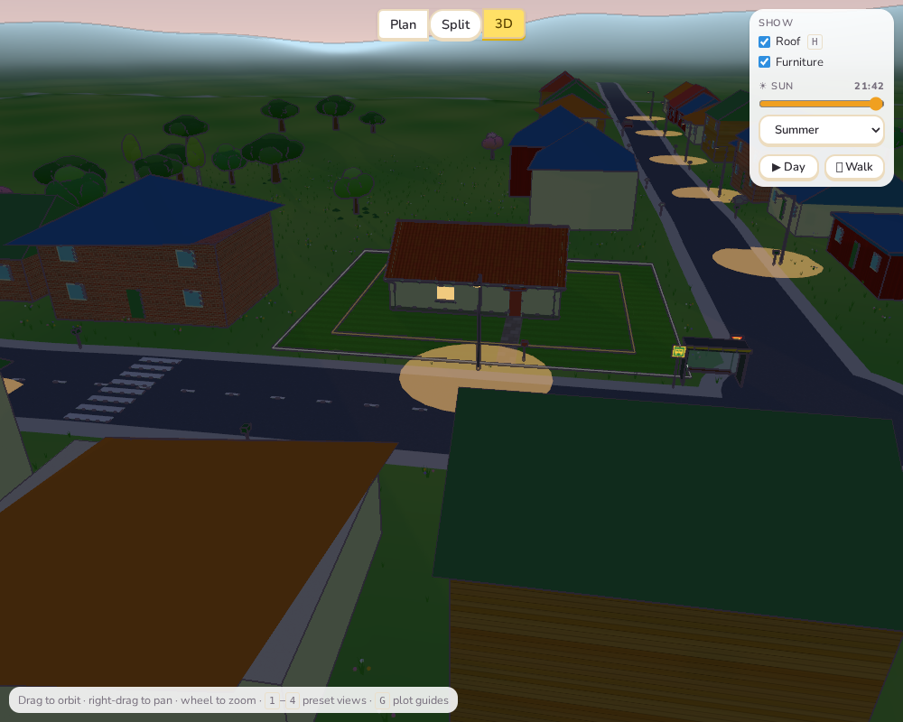
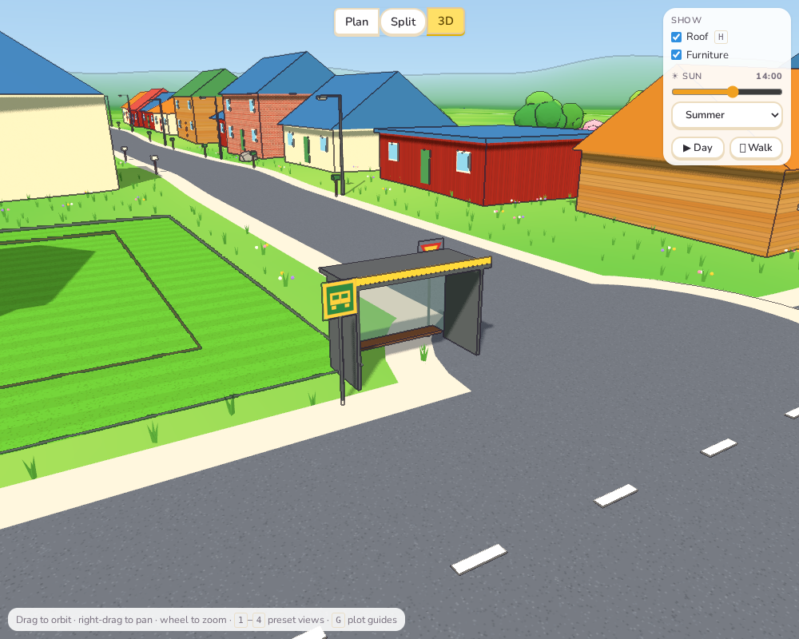
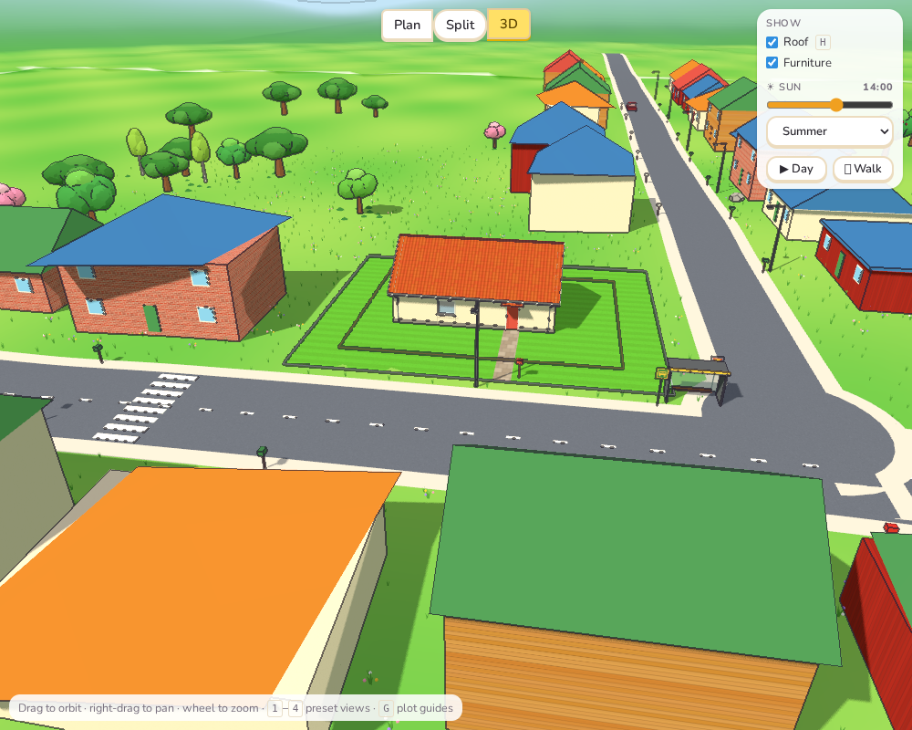
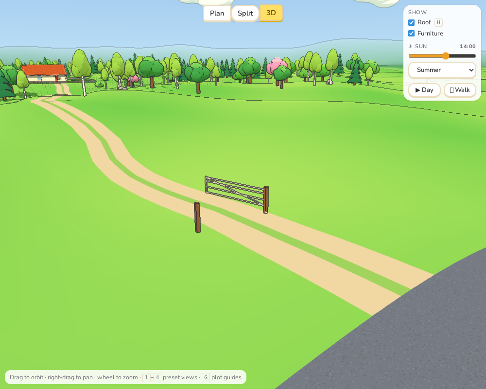

# Sprint 6: Roads and streets

## Plan

- Street lamps.
- Parked cars.
- Road signs.
- A bus stop.
- Letterboxes.
- Rounded corners where roads meet.
- Zebra crossings.
- A gate on gravel tracks.

## What was done

**Where things go (`src/core/street.ts`).** `streetFor(plot)` works out everything along
the roads from the plot's scenery. It is cached and the same every time. Nothing stands
on the plot, in the water or on another road's tarmac, and only things within about
150 m of the plot are made.

**Street lamps.** They stand along every paved road:

- **Spacing:** every 28 m on main and residential streets (on alternating sides of a main
  road), and every 40 m on country lanes.
- **Look:** a grey pole with an arm reaching over the road.
- **At dusk:** the lamp lights up and throws a warm pool of light on the tarmac. This is
  the same evening setting as the windows and indoor lamps.

**Parked cars.** Here and there by the kerb on residential streets and lanes, facing
either way, in five colours. None park in front of the player's plot, where the drive
comes out. They use the same car model as the garage.

**Signs.**

- A **give way** sign (red-bordered triangle) on a road where it meets another.
- A **30** sign on the residential street past the plot.
- A **bus stop** sign by the shelter.

The sign faces are small drawings on canvases, in the Swedish style: yellow inside a red
border.

**Bus stop.** On plots by a main road, there is a shelter on the plot's side of the road,
a little way along from it:

- glass back and end walls;
- a roof with a yellow band;
- a wooden bench;
- the sign beside it.

The plan shows it as a yellow box.

**Letterboxes.** Every neighbour gets a letterbox on a post at the road end of their
way in, in green, blue, red or white. The player's house gets its own red one beside the
path where it meets the road.

**Rounded corners.** Where a paved road ends on another, a disc of tarmac (and kerb, on
streets) at the mouth rounds the corners. Before, the two roads simply overlapped with
square ends.

**Zebra crossings.** On the main or residential street nearest the plot, white stripes
cross the road a little way along from the plot, clear of its drive. They show in the
plan too.

**A gate on gravel tracks.** A track that leaves a lane gets a farm gate a few metres in,
on two wooden posts, swung open.

## Tests

- `street.test.ts` (4 new tests):
  - the street furniture is the same each time;
  - on every plot, nothing stands on the plot or in the water, and every plot with a
    street or main road has lamps;
  - a bus stop appears only by main roads, crossings appear, and every plot with a gravel
    track has a gate;
  - rounded corners only where two paved roads meet.
- All 217 unit tests, the end-to-end tests and the build pass.

## Deviations and notes

- **No rounded corners for gravel tracks.** My first version also put a tarmac disc
  where a gravel track joins a lane. It looked like a car park on a forest road, so
  tracks now just run into the road.
- **A plan bug fixed on the way.** Neighbours' hip roofs were drawn in the plan as solid
  black shapes. This dated from the plot work, not this sprint. The ridge lines were
  four-point polylines with no `fill: none`, so SVG filled them black. Fixed.
- **Lamps don't know about the house.** Lamps are worked out from the plot alone (so they
  are the same whatever is built). One can stand near the end of the player's path.
- **Lamps are not real lights.** As indoors (Sprint 4), the light on the road is a soft
  disc drawn on it, not a light source.
- **No street names on signs.** Swedish street name signs would need a name for every
  road; the plan already labels them.
- **Some street ends run past the junction.** On a few plots, a residential street runs
  a few metres past the main road it meets, from how the roads were laid out in the plot
  work. The rounded corner is on the side that matters. Trimming those ends is left for
  a later look at the road network.
