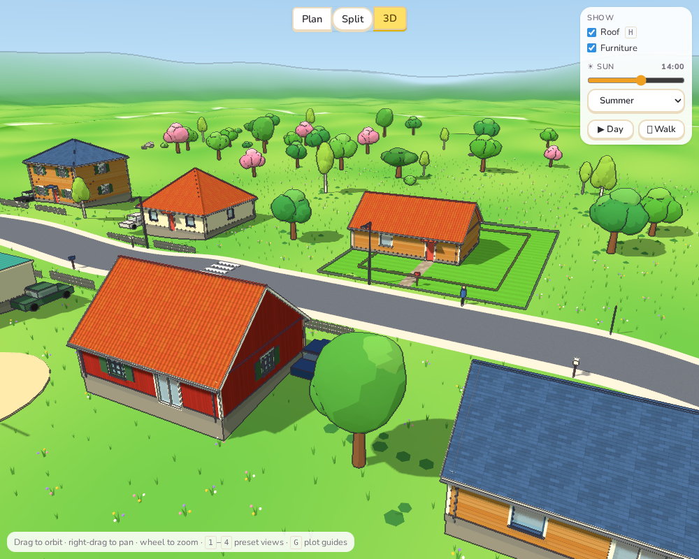
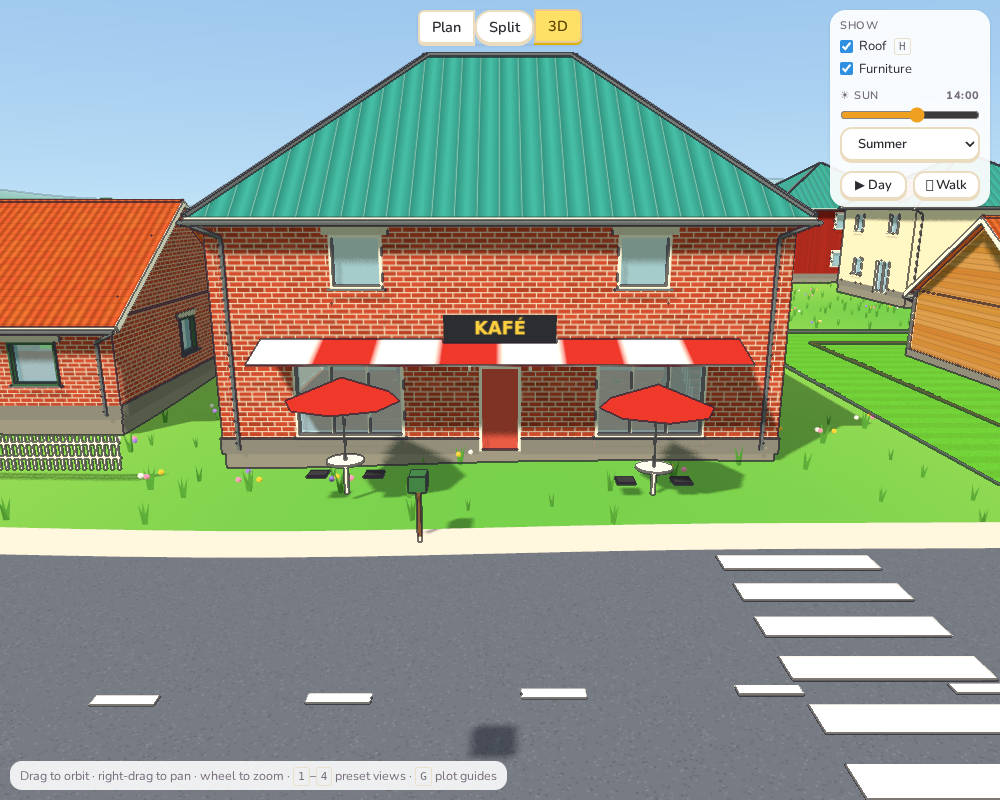
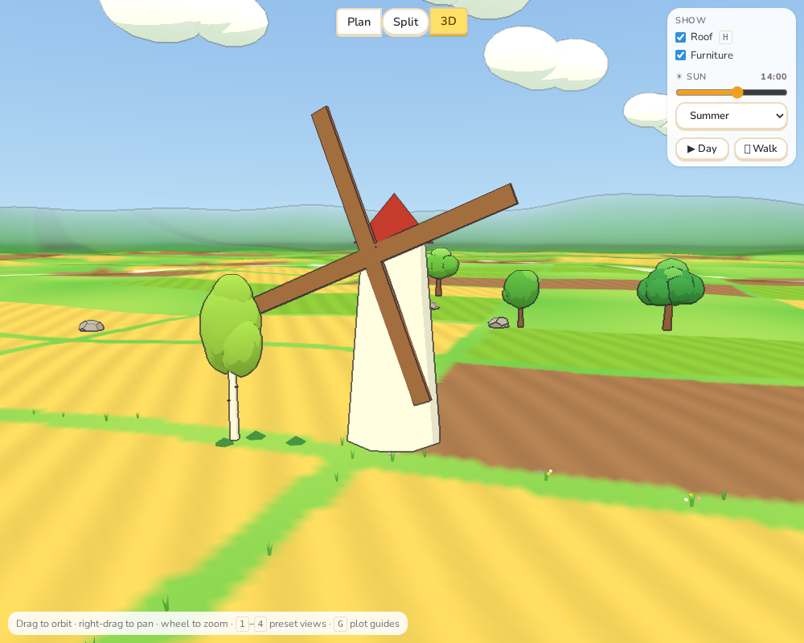
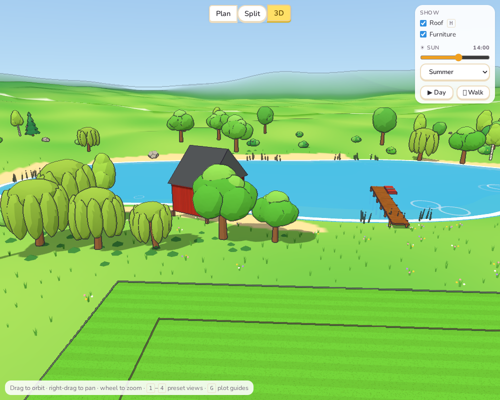
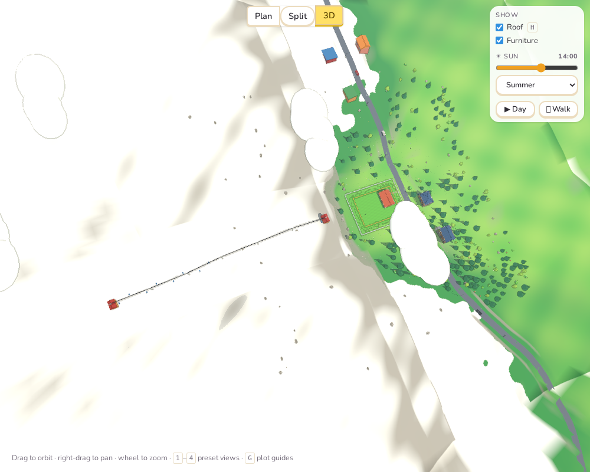

# Sprint 7: Neighbours, town and life

## Plan

- Neighbours built from the game's own house parts, with gardens, fences and cars.
- Shops and a café in town.
- Landmarks that move: windmill sails, boats, the ski lift.
- People, a dog, cars and birds.
- Simpler detail far away, so more fits.

## What was done

**Neighbours are houses of the game** (`src/core/neighbors.ts`). Each neighbour is now a
real `House`, made from its size, facade, roof and storeys, with:

- **Openings:** a front door, two windows at the front, one in each side, and a glass
  door and a window at the back.
- **Two storeys:** a second storey with its own windows and **stairs** up to it.
- **Roof:** a gable, hip or flat roof in the game's own coverings, pitched 28–42°.
- **Chimney:** a fireplace, and so a chimney, in about two houses in five.
- **Window style:** cottage windows with shutters on some wooden houses, modern ones on
  some plastered houses, and frames in white, green, blue or black.

The same `buildHouse` that draws the player's house draws them. So they get everything
from Sprints 3 and 4: sills, lintels, trim, corner boards, plinths, gutters and down
pipes, ridge caps, door canopies, glowing windows at dusk and snow on the roof. The same
neighbour always gives the same house.

In front of each one, if the road leaves room, there is a low white picket fence with a
gap for the path. Beside it, if there is room, a car stands on the drive.

**Shops and a café in town.** On town plots, the four neighbours nearest the plot are a
**café**, a **bakery**, a **grocer** and an **ice-cream shop**. Each has:

- wide shop windows each side of the door;
- a striped awning (red, green, blue or yellow);
- a sign in Swedish: KAFÉ, BAGERI, LIVS, GLASS.

The café also has two tables outside with chairs and red parasols.

**Things that move.** The world's `update(t)` (Sprint 2) now runs a list of movers:

- **Windmill sails** turn slowly on their hub.
- **Ski lift chairs** go up one side of the cable and down the other, round and round.
- **Boats:** a red rowing boat bobs by the jetty. On wide enough open water, a sailing
  boat sails slow circles.
- **Cars** drive the main and residential streets, on the right, up to four at a time.
- **People** walk up and down the pavements near the plot, swinging their legs. The
  first one has a **dog** trotting ahead.
- **Birds** circle high over the plot, flapping now and then and gliding in between.
  Their shadows cross the ground.

Everything is placed for time 0 when the world is built, so still screenshots (and tests,
where motion is off) show it all in place.

**Simpler far away (level of detail).**

- **Near neighbours:** those within 80 m of the plot are full houses of the game.
- **Far neighbours:** the rest keep the simple block houses from before.
- **Merging:** a full house is about 174 meshes. Each near house (and each neighbour's
  fence) is merged into **one mesh per material**, about a dozen. On the suburban plot,
  9 of the 18 neighbours are full houses, and the whole scene has about 1,800 meshes.

## Tests

- `neighbors.test.ts` (4 new tests):
  - **Full houses:** every neighbour on every plot (more than 50) is a whole house:
    - its footprint closes;
    - its roof builds;
    - every room can be reached (stairs included);
    - the storeys match;
    - the front door faces the way the neighbour faces.
  - **Same each time:** neighbours are built the same each time; some, not all, have
    chimneys.
  - **Shops:** on town plots the nearest neighbours are the café, bakery, grocer and
    ice-cream shop, with two shop windows each; there are no shops elsewhere.
  - **`pointAlong`** (used by cars and walkers): the point and direction along a polyline,
    clamped at the ends.
- In the browser, the windmill is drawn at two times and the two pictures differ (the
  sails turn). The ski lift and the boat are checked the same way, by stepping
  `update(t)` by hand.
- All 221 unit tests, the end-to-end tests and the build pass.

## Deviations and notes

- **Motion only shows in a real browser.** As in Sprint 2, nothing moves under automated
  testing (`navigator.webdriver`). The screenshots step the clock by hand.
- **Walkers go through things.** People and the dog follow the pavement line. They don't
  avoid lamp posts or letterboxes, and they walk through the café tables if those stand
  on their stretch. Cars don't stop at crossings or for each other.
- **The level of detail is by distance from the plot, not from the camera.** It is decided
  once, when the world is built. Walking (Sprint 2) far from the plot shows block houses
  close by. Switching by camera distance would mean keeping two versions of every house.
- **Sail boats need room.** The sailing boat only appears where there is a 14 m circle
  of open water near the plot. On small or narrow lakes there is only the rowing boat.
- **A bug found on the way:** the café's sign was first hidden inside the wall. Walls are
  centred on the outline and thick, so a sign 12 cm out was still inside. It now stands
  35 cm out.
- **No birds' nests, cats or cyclists.** The plan said "people, a dog, cars and birds",
  and that is what there is.
