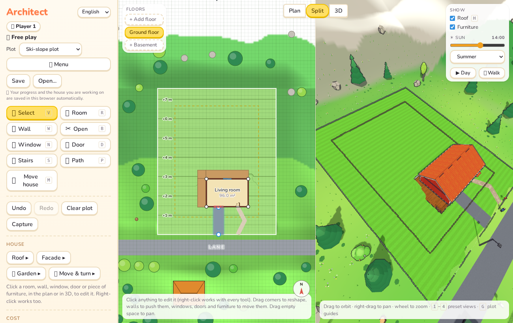
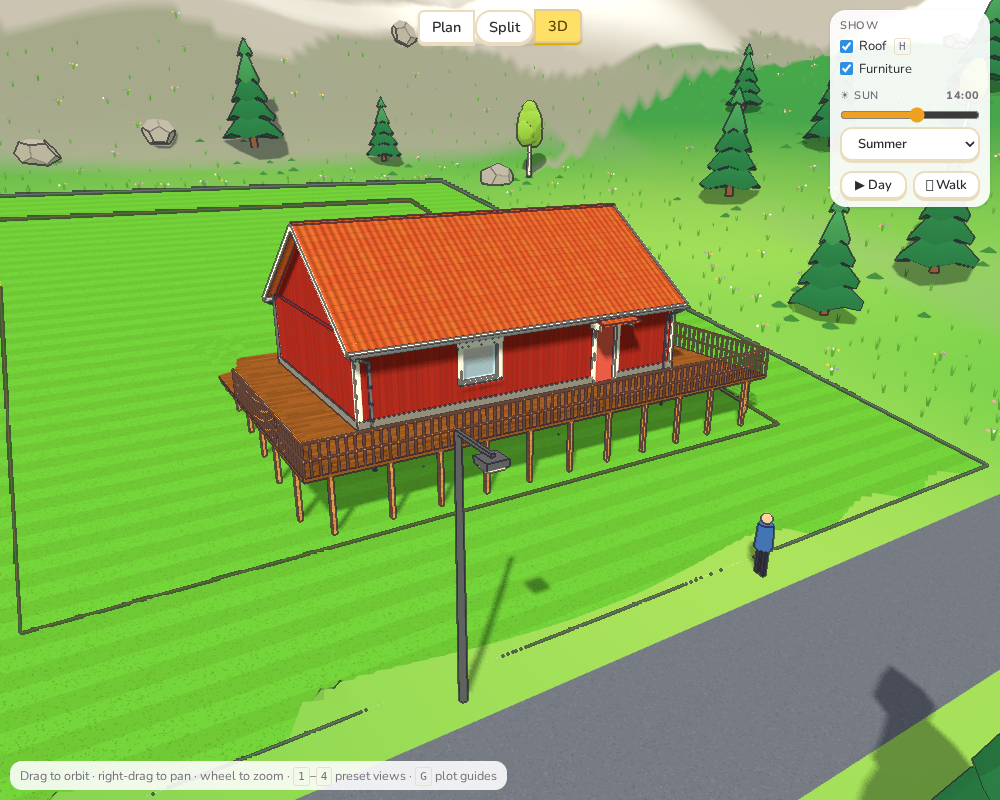
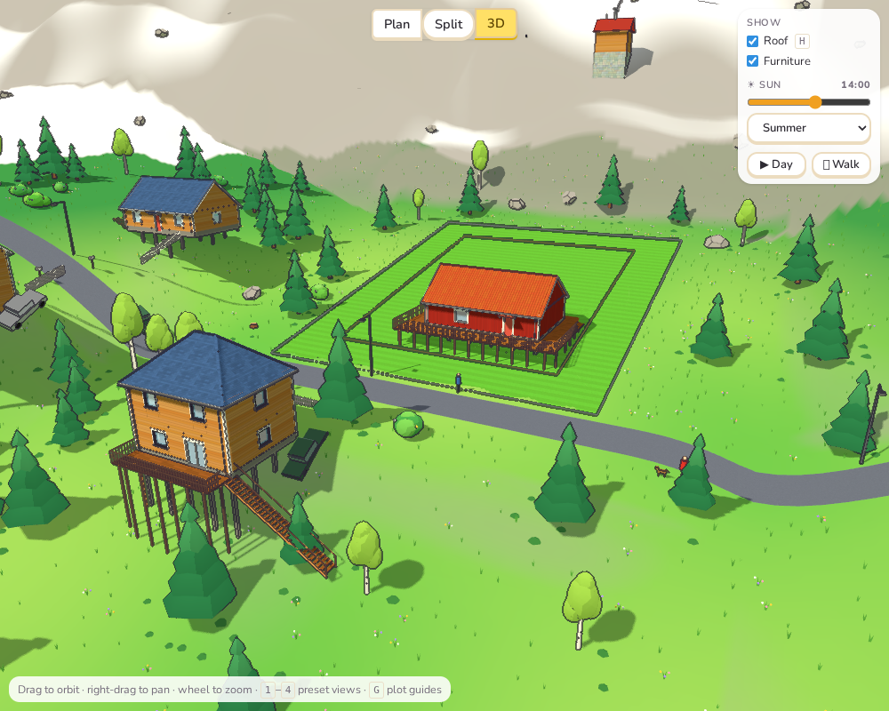
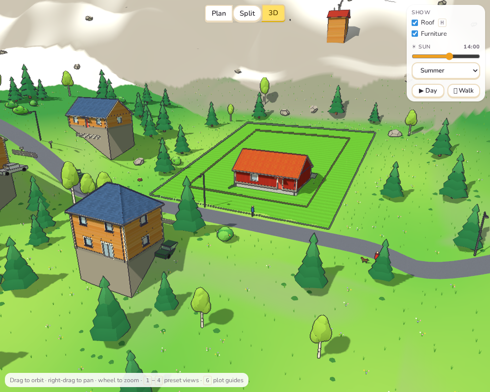
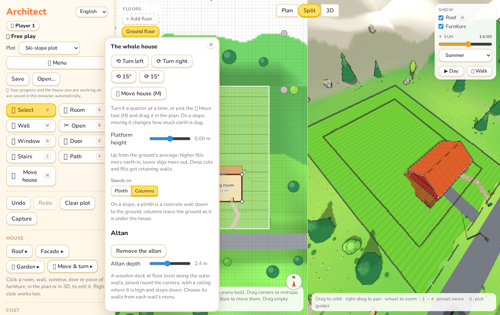

# Sprint 8: Slopes, columns, altans and your own paths

Feedback after Sprint 7, and what was done about it.

## Plan

1. **The Day button could not be stopped.** Once the day was playing, clicking the
   button again did nothing.
2. **Paths, drives and steps appeared on their own.** Players want to lay paths
   themselves.
3. **Things floated or sank on sloping ground:** cars on the roads and by the houses,
   among others.
4. **Houses on steep ground stood on gigantic basements.**
5. **Columns, and altans:** houses on columns on steep ground, and wooden decks round
   them.

## What was done

**1. The Day button.** While the day plays, the clock in the Show panel changes every
frame. The whole panel was being rebuilt each frame, so the button under the pointer was
replaced between pressing and releasing it, and the click never landed. Now the panel is
built once, and the clock, the slider and the play button are updated in place.

The end-to-end test checks that a second click stops the day. Against the old code it
fails exactly as players saw: the button keeps "detaching from the DOM".

**2. Paths and drives are yours to lay.** Nothing is laid automatically any more:

- **The Path tool** (🛤️, key **P**). Click from the road (the plot's edge where the road
  is) to a door, point by point. Points snap to doorsteps, to the road's edge and to the
  grid. Reaching a door ends the path, and so do Enter, a double-click or clicking the
  last point again. Esc cancels.
- **Drives.** A path that ends at a garage door becomes a drive (3 m wide, tarmac, or
  gravel off a gravel road).
- **Editing.** Click a path to select it, then drag its points. Its menu switches it
  between **Path** and **Drive** and between **Paving**, **Gravel** and **Tarmac**, shows
  its length, and deletes it. Paths stay put when the house is moved.
- **Costs and rules.** Paths and drives cost by the square metre as before. A garage door
  still needs a drive from the road, now one you have laid; it can also join a drive that
  reaches the road. The warning tells you to lay one.
- **Fences and gates** follow your paths: a gate where a path crosses, a gap for a drive.
- **Steps and ramps are a door's choice.** A raised door's menu shows how high its floor
  is and offers **None**, **Steps** or **Ramp**; nothing is built until you choose. Old
  saves that had a ramp keep it.

**3. Things on sloping ground.**

- **Cars** on the roads (parked and driving) sit on the road's surface, nose up or down
  its slope.
- **Neighbours' cars** sit tilted to the ground they stand on.
- **Neighbours' fences** follow the ground picket by picket.
- **The bus shelter** stands on a level concrete base.
- **Garden sheds, greenhouses, vegetable patches and flower beds** stand level on a base
  up to the ground's highest corner. Ponds are dug in. Trampolines and swings stand on
  their legs.
- **Terrace posts** reach down to the ground, however far that is; they used to be 3 m
  long whatever the ground did. A high terrace gets steps down from its front.
- **High steps** (over a metre) are open wooden stairs with stringers, treads and a
  handrail, not a solid concrete wedge.

**4 and 5. Columns and altans.**

- **Foundation choice.** On a sloping plot, the whole-house menu (**Move & turn**) has
  **Stands on: Plinth / Columns**.
  - *Plinth* is as before: concrete walls down to the ground.
  - *Columns:* the ground is left as it is downhill and under the house. The house stands
    on a slab and columns, about 2.4 m apart round the edge and under the middle, from
    the ground up to the floor. You see the hillside under it.
- **Cost of columns.** Columns cost by the column and by their height, instead of square
  metres of foundation wall, and less earth is filled in. A house with a basement always
  stands on its walls.
- **The altan.** It is a wooden deck at floor level along the ground floor's outer walls,
  joined round the corners. On sloping ground it has:
  - posts down to the ground;
  - a railing wherever it is more than half a metre up;
  - steps down where it is nearest the ground.
- **Adding one.** Use *+ Altan round the house* in the whole-house menu (with a depth
  slider, 1.2–4 m), or *+ Altan along this wall* in any outer ground-floor wall's menu.
- **For clients and costs.** The altan counts as a terrace for clients, including sunny
  terraces and evening sun. A door onto it needs no steps of its own. It costs like a
  terrace deck, and needs the Terraces technique. It shows in the plan, and clicking it
  opens the whole-house menu.
- **Neighbours on steep ground** (more than 0.8 m across their footprint) now stand on
  columns, with an altan on their downhill side and wooden stairs down. Far-away
  neighbours stand on a few columns, not a tall block.
- **Churches, barns and the ski lift stations** stand on a stone base up to the ground's
  highest corner. Before, their walls ran down to the lowest corner and made towers.

## Tests

- **Paths** (`access.test.ts`, rewritten, 5 tests):
  - nothing is laid on its own;
  - a path leads to the door it ends at, and costs by area and surface;
  - a garage needs a drive from the road (a path is not enough; a drive in the middle of
    the garden is not either; one joined to a drive from the road is);
  - points snap to doorsteps and the road's edge;
  - paths are saved.
- **Columns and altans** (`foundation.test.ts`, 8 tests):
  - **Columns:**
    - they stand under the house from the ground to the floor, with no foundation wall
      showing, and are paid for;
    - the ground is natural downhill and less earth is filled;
    - none with a basement or on flat ground.
  - **Altans:**
    - an altan round the house has eight pieces (four sides, four corners), the right
      area, and edges that are all outside;
    - one along a single wall is one strip;
    - it has steps down when high, and a door onto it gets no steps;
    - it meets the "terrace" and "sunny terrace" wishes, costs like a deck, and needs
      Terraces;
    - the foundation and the altan are saved.
- **Steps** (`details.test.ts`): a raised door gets steps only when chosen; old saves with
  a ramp keep it.
- **e2e:**
  - the Path tool lays a path from the street to the front door;
  - the Day button starts and stops the day;
  - the cost chart starts with no paths box.
- All 230 unit tests, the end-to-end tests and the build pass.

## Deviations and notes

- **Saved designs lose their paths.** Designs saved before this sprint had paths and
  drives worked out automatically, and those are not stored. After loading, lay them
  again; a garage warns until it has a drive.
- **A front door without a path is not a warning.** Only garages need a way in (a drive);
  a path to the front door is the player's choice.
- **Columns are a choice, not automatic.** The player's house keeps its plinth unless
  columns are chosen. Neighbours choose for themselves: columns on steep ground.
- **Altan corners are joined only where the house sticks out.** At inner corners (an L's
  inside corner), the two strips meet and overlap, which looks right. The steps down are
  where the ground is highest, one flight; a big altan might want more.
- **Railings follow the ground per 25 cm.** Where the ground is near half a metre below
  the deck, the railing can start and stop over a short stretch.
- **Paths don't climb.** Paths follow the ground as drawn; a steep path has no steps of
  its own.
